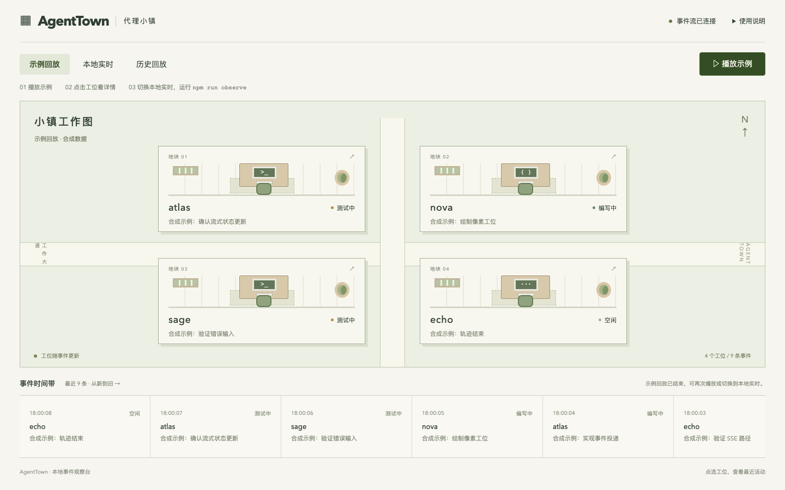
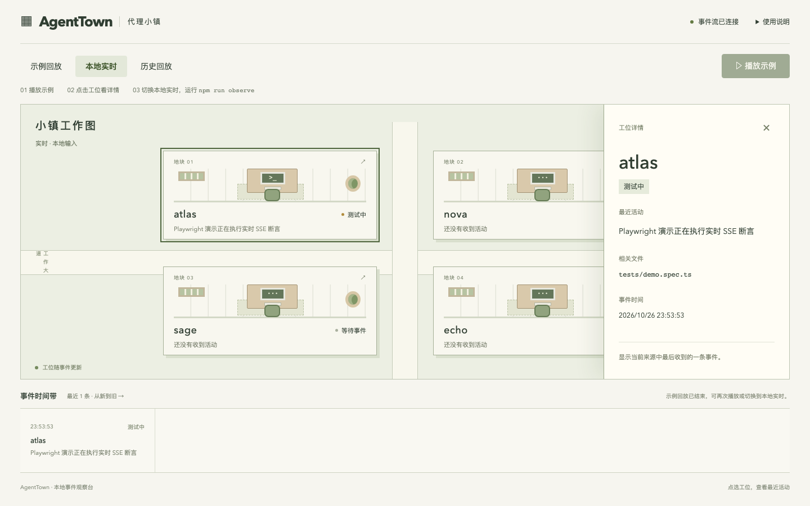

# AgentTown · 代理小镇

把代理的活动放到一张小镇地图上。每个代理占一个工位；收到规划、编写、测试或错误事件时，工位随之更新。适合在跑多个任务时，看一眼谁在忙，再点开最近一条活动。



地图是主界面，底部是最近 30 条事件。点击工位或时间带中的事件，右侧展开详情。界面支持中文、键盘操作和手机屏幕。

## 启动

需要 Node.js **22.12+（22.x）、24.x 或 26+**，不支持 23/25。推荐 24 LTS。

```sh
npm run setup
npm run doctor
npm run dev
```

打开 [本地小镇](http://127.0.0.1:4201)。`setup` 安装锁定的 npm 依赖、Chromium 和录屏组件；macOS、Windows、Linux 使用相同命令。首次安装需要联网，Linux 还需 Chromium 系统运行库。浏览器默认保存在项目 `.browsers/`，可用 `PLAYWRIGHT_BROWSERS_PATH` 指向已有兼容缓存。

只运行网页，不做浏览器测试，也可以执行 `npm ci --cache .npm-cache` 后运行 `npm run dev`。API 端口为 5201。停止服务请在启动它的终端按 Ctrl+C。

## 看一次真实操作

先点击 **播放示例**，观察四个工位变化。这部分是明确标注的合成数据，不需要密钥。

然后切到 **本地实时**，在另一个终端执行：

```sh
npm run observe
```

脚本实际运行本项目单元测试，将开始和退出状态送到 Atlas 工位。点击 Atlas，即可查看最近活动和相关文件。下面截图来自真实 Playwright 测试过程：测试进程发送事件，经 API 和 SSE 更新到页面，再打开工位详情。



## 接入与范围

向 `POST /api/events` 发送 `ts`、`agentId`、`type`、`message`、`source`，可附带 `file`。`source` 为 `live`、`replay` 或 `imported`，分别对应三个来源页签。历史回放展示收到的 imported 事件。

目前完成的是本地事件到地图的闭环，任务状态为 **PARTIAL**。尚未接入 Codex / Claude 原生日志，也没有真实九代理冲刺回放或模型推理。实时表示即时接收，来源由发送方声明。事件仅存内存，最多 500 条，重启后清空；文件名仅展示，不读取文件。服务只绑定本机，不应公开暴露。

## 验证

```sh
npm run build
npm run test
npm run e2e
npm run demo
```

浏览器测试会自己启动服务，运行前请停止 `npm run dev`。`demo` 会重新生成上面两张真实截图，并在本地 `artifacts/playwright/demo/` 保存录像。

本次在 macOS 验证了构建、单元测试、真实浏览器流程、1440×900 和 390 宽度界面。使用已有浏览器缓存；全新机器下载和 Windows/Linux 实机尚未验证。安装细节、依赖用途、API 字段与故障处理见 [安装与接入说明](docs/setup-and-api.md)，检查结果见 [status.json](status.json)。

React · TypeScript · Vite · Express · SSE。地图由 CSS 绘制，无外部图片或字体依赖。MIT 许可。
